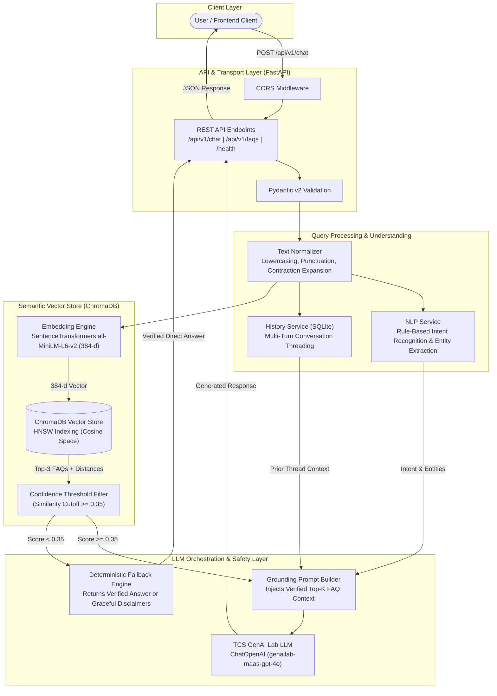
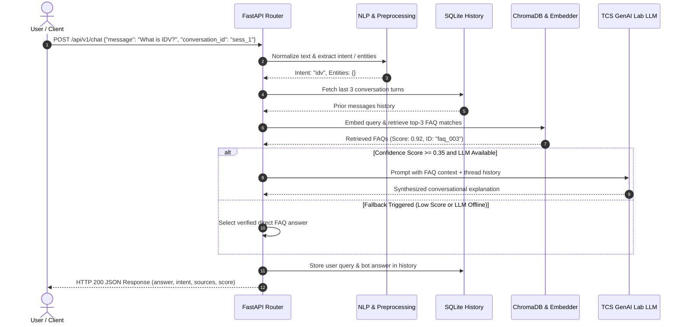

# 🚗 AI-Powered Vehicle Insurance FAQ Chatbot - Backend

A production-grade, modular, and enterprise-ready backend for an AI-powered Vehicle Insurance FAQ Chatbot. The backend combines **FastAPI**, **Sentence Transformers**, **ChromaDB**, **LangChain**, and **TCS GenAI Lab LLM** (`genailab-maas-gpt-4o`) to provide factual, context-aware answers to motor insurance queries under Indian regulatory standards.

---

## 🏛️ System Architecture

The backend is built as a multi-tier Retrieval-Augmented Generation (RAG) system with strict anti-hallucination guardrails and rule-based NLP pre-classification.



---

## 🧩 Architectural Layers & Components

### 1. API & Transport Layer
- **FastAPI Framework:** Handles asynchronous HTTP requests with high throughput and low latency.
- **CORS Middleware:** Configured to accept cross-origin requests from modern single-page applications and local dev servers.
- **Application Lifespan:** On application startup, the lifespan hook inspects ChromaDB, automatically initializing and indexing the FAQ dataset if the vector collection is empty.
- **Pydantic Validation:** All incoming payloads and outgoing responses strictly conform to validated schemas, preventing injection attacks and type inconsistencies.

### 2. Query Preprocessing & NLP Layer
- **Text Normalization:** Strips surplus whitespace, expands contractions, handles special characters, and filters conversational noise.
- **Rule-Based Intent Recognition:** Classifies inquiries into specific motor insurance categories, including `third_party_insurance`, `comprehensive_insurance`, `claim_process`, `idv`, `ncb`, `policy_renewal`, `endorsement`, and `exclusions`.
- **Entity Extraction:** Detects vehicle types (car, bike, commercial), policy types, claim registration numbers, policy numbers, and financial/IDV figures to provide enriched context.

### 3. Context & Multi-Turn History Layer
- **SQLite Storage:** Persistent, thread-safe relational database for conversation threads.
- **Contextual Sliding Window:** When a user asks follow-up questions (e.g., *"How does this affect my premium?"*), the system loads prior conversation turns and appends contextual anchors to maintain conversational continuity.

### 4. Semantic Retrieval & Vector Database Layer
- **Sentence Transformers (`all-MiniLM-L6-v2`):** Maps questions into compact 384-dimensional dense vector embeddings optimized for semantic search.
- **ChromaDB:** Local, embedded vector database utilizing Hierarchical Navigable Small World (HNSW) graphs in cosine similarity space (`1 - cosine_distance`).
- **Confidence Gate:** Queries resulting in similarity scores below `0.35` are discarded to prevent out-of-domain hallucinations.

### 5. LLM Orchestration & Anti-Hallucination Guardrails
- **TCS GenAI Lab Integration:** Utilizes `ChatOpenAI` pointed to the enterprise endpoint (`genailab-maas-gpt-4o`) with custom SSL configurations.
- **Strict Grounding:** The system prompt constrains the model exclusively to the retrieved FAQ context. The assistant is instructed never to fabricate policy numbers, claim approvals, or personal premium figures.
- **Dual-Tier Fallback Mechanism:** If the external LLM is offline or unconfigured, the system automatically falls back to the exact verified answer from the indexed dataset, ensuring high availability.

---

## 🔄 End-to-End Data Flow



---

## 🛠️ Technology Stack & Rationale

| Technology | Purpose | Rationale |
|---|---|---|
| **Python 3.11+** | Runtime | Enhanced execution speed, robust typing, and broad async support. |
| **FastAPI** | REST API Framework | Native asynchronous handling, auto-generated OpenAPI documentation, and high performance. |
| **Pydantic v2** | Data Schemas | High-speed C-based schema validation and serialization. |
| **Sentence-Transformers** | Dense Vector Embeddings | Lightweight 384-dimensional representations with low inference latency and high semantic recall. |
| **ChromaDB** | Vector Database | Embedded vector engine requiring zero separate server infrastructure, storing embeddings persistently. |
| **LangChain** | LLM Orchestrator | Industry-standard abstraction for prompt templating and OpenAI-compatible API interaction. |
| **SQLite3** | Session Storage | Zero-maintenance, local transactional storage for multi-turn history. |
| **Pytest** | Automated Testing | Comprehensive unit and integration test coverage for endpoints and services. |

---

## 📡 API Specifications

### 1. Send Chat Message
- **Endpoint:** `POST /api/v1/chat`
- **Headers:** `Content-Type: application/json`

**Request Body:**
```json
{
  "message": "What is the difference between comprehensive and third-party insurance?",
  "conversation_id": "session_user_01"
}
```

**Response Body (HTTP 200):**
```json
{
  "answer": "Third-party insurance is legally mandatory in India and only covers damages or injuries caused to other people or property. Comprehensive insurance includes third-party coverage plus own-damage protection against accidents, theft, fire, and natural disasters.",
  "intent": "comprehensive_insurance",
  "entities": {
    "policy_type": "comprehensive"
  },
  "sources": ["faq_001", "faq_002"],
  "confidence_score": 0.89
}
```

### 2. List FAQs Catalog
- **Endpoint:** `GET /api/v1/faqs?category=claims`
- **Response:** Paginated or filtered list of indexed FAQs with IDs, questions, verified answers, and keyword tags.

### 3. Service Health Check
- **Endpoint:** `GET /health`
- **Response Body:**
```json
{
  "status": "healthy",
  "faq_indexed_count": 55,
  "vector_store": "ChromaDB",
  "embedding_model": "sentence-transformers/all-MiniLM-L6-v2",
  "llm_model": "genailab-maas-gpt-4o"
}
```

---

## 🚀 Setup & Execution Guide

### 1. Prerequisites
- Python 3.11 or later
- Git

### 2. Virtual Environment Setup
```powershell
# Create virtual environment
python -m venv venv

# Activate virtual environment (Windows PowerShell)
.\venv\Scripts\Activate.ps1

# Activate virtual environment (Linux / macOS)
source venv/bin/activate
```

### 3. Install Dependencies
```bash
pip install --upgrade pip
pip install -r requirements.txt
```

### 4. Environment Variables Configuration
Copy the template to create your `.env` file:
```bash
cp .env.example .env
```
Configure your credentials in `.env`:
```env
TCS_API_KEY=your_actual_api_key_here
TCS_BASE_URL=https://genailab.tcs.in
TCS_MODEL=genailab-maas-gpt-4o
TCS_VERIFY_SSL=false
EMBEDDING_MODEL_NAME=sentence-transformers/all-MiniLM-L6-v2
CHROMA_PERSIST_DIRECTORY=chroma_db
FAQ_DATA_PATH=data/vehicle_insurance_faqs.json
SIMILARITY_THRESHOLD=0.35
APP_HOST=0.0.0.0
APP_PORT=8000
DEBUG=true
```

### 5. Ingest FAQs Dataset
Populate ChromaDB with the initial 55 verified insurance FAQs:
```bash
python scripts/ingest_faqs.py
```

### 6. Start the FastAPI Server
```bash
uvicorn app.main:app --host 0.0.0.0 --port 8000 --reload
```
- API Base URL: `http://127.0.0.1:8000`
- Interactive Swagger UI: `http://127.0.0.1:8000/docs`
- ReDoc UI: `http://127.0.0.1:8000/redoc`

### 7. Run Automated Tests
```bash
pytest
```
